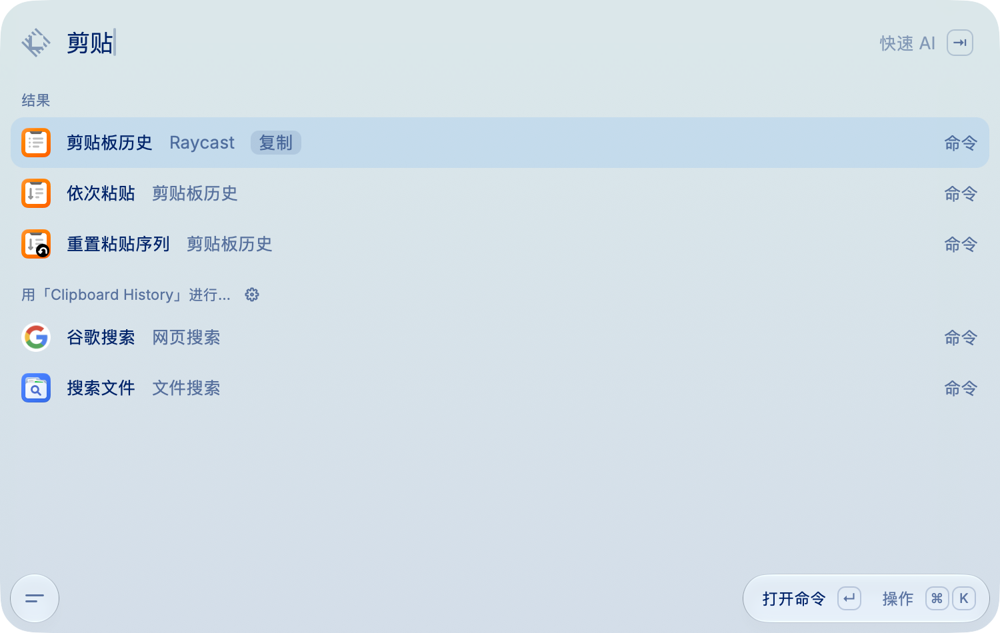
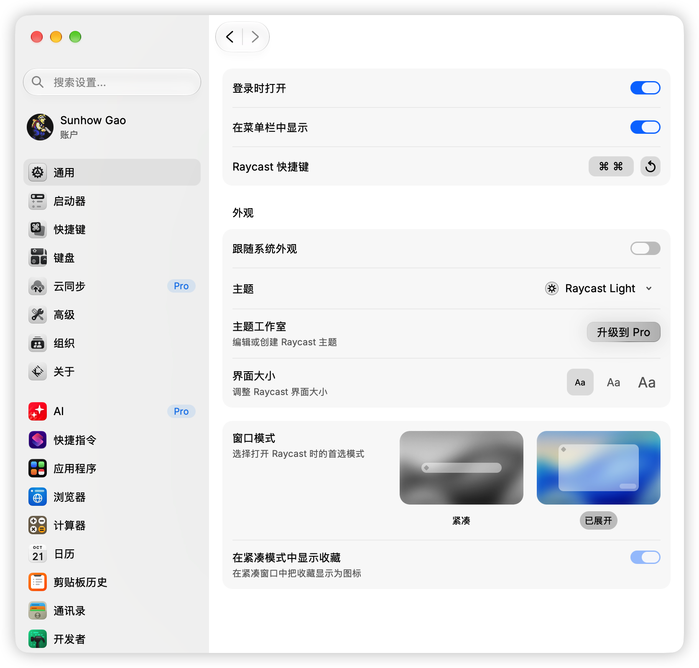

<h1 align="center"><a id="zh"></a>Raycast 简体中文汉化</h1>

<p align="center"><em>让每一次 ⌘ Space，都落在母语里。</em></p>

<p align="center">
  <a href="#english">English</a> ｜ 简体中文
</p>

<p align="center">给 <a href="https://raycast.com">Raycast</a> 加一层中文界面：不改二进制、不碰业务逻辑，中文搜索也能命中它原本的英文索引。</p>

<table align="center">
  <tr>
    <td width="50%"></td>
    <td width="50%" align="center"></td>
  </tr>
  <tr>
    <td align="center"><sub>启动器 · 中文搜索</sub></td>
    <td align="center"><sub>设置窗口 · 界面汉化</sub></td>
  </tr>
</table>

<p align="center"><sub>非官方项目 · 原理见 <a href="#实现原理">实现原理</a></sub></p>

<h2 align="center">交给 AI 安装</h2>

<p align="center">不想自己敲命令？把下面这句话原样发给任意 AI Agent（Codex、Claude Code、Cursor…），它会帮你装好并验证。</p>

```
帮我安装 https://github.com/JaffryGao/raycast-zh 这个 Raycast 简体中文汉化：把仓库克隆到本地，运行 npm run deploy（没有 Node.js 就改用 ./scripts/install.sh），装完跑 npm run status 确认所有窗口都已注入，再把结果告诉我。
```

<h2 align="center">特性</h2>

- **界面汉化**：约 5500 条精确匹配文案，覆盖启动器、设置、侧栏、空状态与占位符
- **中文搜索**：输入「设置 / 剪贴 / 专注 / 截图」，命中对应的英文命令
- **零侵入**：只在各窗口 HTML 末尾加一段 `<script>`，不改任何 JS chunk 与二进制
- **未命中即原样**：不认识的文本保持英文，不会破坏文件名或你的 Quicklink 标题
- **可一键还原**：`npm run undeploy` 完全回到原样；升级后重跑 `npm run deploy` 即恢复

<h2 align="center">环境要求</h2>

<p align="center">macOS · Raycast（实测 2.9.0.0）· Node.js ≥ 16（可选，只用安装脚本则不需要）</p>

<h2 align="center">快速开始</h2>

```bash
git clone https://github.com/JaffryGao/raycast-zh.git
cd raycast-zh
npm run deploy
```

没有 Node.js 也能装（仓库已带构建产物）：

```bash
./scripts/install.sh
```

脚本会找到 Raycast 的 `frontend/` 目录，注入所有窗口页面，然后重启 Raycast。唤起后输入 `设置`、`剪贴` 试试。

<h2 align="center">常用命令</h2>

| 命令 | 作用 |
| --- | --- |
| `npm run deploy` | 安装 / 更新 |
| `npm run undeploy` | 完全卸载，恢复原样 |
| `npm run status` | 体检：注入覆盖、版本同步、是否被升级覆盖 |
| `npm test` | 分层测试（128 条断言，含真实语料覆盖率闸门） |
| `npm run build` | 改完词典后重建 `dist/` |

`install.sh` / `uninstall.sh` 支持 `--no-restart`；三个脚本都支持 `--app <路径>`。

<h2 align="center">Raycast 升级之后</h2>

升级会整体替换 app bundle，注入随之消失。每次升级后跑一次：

```bash
npm run deploy
```

不确定就先 `npm run status`：显示「已汉化且与源码同步」就不用处理。

> 若自动更新因 bundle 被改动而失败，从[官网](https://raycast.com)覆盖安装后再执行一次即可。

<h2 align="center">只汉化了一半？</h2>

Raycast 每个窗口都是**独立的 HTML + 独立 JS 入口**（启动器、设置、AI 对话、笔记……）。只注入 `main-window.html` 会导致「启动器中文、设置全英文」。当前版本会遍历 `frontend/*.html`，并自动覆盖以后新增的窗口。

```bash
$ npm run status
✓ 窗口已注入         9/9
```

显示 `8/9` 时直接 `npm run deploy` 补齐，无需先卸载。

<h2 align="center">实现原理</h2>

**1. 渲染层翻译**：扫描 DOM 文本节点和 `placeholder` / `title` / `aria-label` / `alt` / `data-tooltip`，精确匹配词典后替换。跳过输入框、`contentEditable`、`CODE`、`SVG`，`MutationObserver` 负责补译 React 新渲染的节点。

**2. 中文搜索**：Raycast 有两套匹配——设置窗口在前端 `indexOf`，hook 字符串方法有效；启动器根搜索在**原生侧**执行，前端模糊匹配用 `charCodeAt` 动态规划，hook 无效。所以启动器改为在 IPC 序列化出口把 `JSON.stringify({ term })` 里的中文换成英文，回包再把 `term` 映射回中文——否则前端「搜索是否落地」的判据失效，回车会被静默吞掉。

**3. 只改该改的**：去程用浅拷贝避免污染 React 状态；只处理键数 ≤3 的薄对象；回程的 `JSON.parse` 产物是全新对象，可安全就地修改。

更多逆向细节见 [`docs/technical-notes.md`](docs/technical-notes.md)。

<h2 align="center">贡献词典</h2>

改完跑 `npm run build && npm test`：

- `src/dict.js`：界面文案，英文 → 中文。未命中就原样显示，宁可少收不要猜。
- `src/alias.js`：中文搜索词 → 单个英文查询词（原生只接受一个 term）。

构建会检查重复键与语法，测试含真实语料覆盖率闸门（设置页要求 100%）。

<h2 align="center">已知限制</h2>

- 全量 UI 语料覆盖约 99%，剩余为开发者预览用的占位文案、文件名与链接
- 单字中文搜索靠猜：输入「设」只会得到 `Setting`，输入第二个字即正常
- 词典完全没有的中文词不做改写，结果为空而非乱译
- 依赖 Raycast 内部结构：注入点需有 `</body>`，搜索改写依赖 `{ term }` 形态；大版本变更时 `npm test` 会先报错
- 左下角按钮首次点击无反应是 Raycast 自身行为，与本项目无关

<h2 align="center">卸载</h2>

```bash
npm run undeploy
```

只删除自己写入的内容：HTML 里的标记块、`raycast-zh.js`、`~/.raycast-zh/state.env`。

<h2 align="center">免责声明</h2>

本项目修改**已安装 app 的资源文件**，属于非官方手段：不联网、不上传数据、不读剪贴板，逻辑全部在本地 WebView 内；但修改 app bundle 不在 Raycast 支持范围内，出问题请先 `npm run undeploy`，风险自担。

<h2 align="center">License</h2>

<p align="center"><a href="LICENSE">MIT</a></p>

---

<h1 align="center"><a id="english"></a>Raycast Chinese (Simplified) Localization</h1>

<p align="center"><em>So every ⌘ Space opens in your own language.</em></p>

<p align="center">
  <a href="#zh">简体中文</a> ｜ English
</p>

<p align="center">An unofficial Chinese UI layer for <a href="https://raycast.com">Raycast</a>: no binary patching, no business-logic changes, and Chinese queries still hit the original English index.</p>

<table align="center">
  <tr>
    <td width="50%"></td>
    <td width="50%" align="center"></td>
  </tr>
  <tr>
    <td align="center"><sub>Launcher · Chinese search</sub></td>
    <td align="center"><sub>Settings · localized UI</sub></td>
  </tr>
</table>

<p align="center"><sub>Unofficial project · see <a href="#how-it-works">How it works</a></sub></p>

<h2 align="center">Let an AI install it</h2>

<p align="center">Don't want to run the commands yourself? Paste this sentence to any AI agent (Codex, Claude Code, Cursor…); it will install and verify it for you.</p>

```
Install the Raycast Chinese localization from https://github.com/JaffryGao/raycast-zh: clone the repo, run npm run deploy (or ./scripts/install.sh if Node.js isn't available), then run npm run status to confirm every window is injected, and report the result back to me.
```

<h2 align="center">Features</h2>

- **Localized UI**: ~5,500 exact-match strings across launcher, settings, sidebar, empty states, and placeholders
- **Chinese search**: type `设置`, `剪贴`, `专注`, or `截图` to reach the English command
- **Non-invasive**: one `<script>` per window HTML; no JS chunk or binary is touched
- **Unmatched text stays English**, so file names and your own Quicklink titles are never mangled
- **One-command rollback**, and one command to restore after a Raycast update

<h2 align="center">Requirements</h2>

<p align="center">macOS · Raycast (tested on 2.9.0.0) · Node.js ≥ 16 (optional if you use the install script)</p>

<h2 align="center">Quick start</h2>

```bash
git clone https://github.com/JaffryGao/raycast-zh.git
cd raycast-zh
npm run deploy
```

No Node.js? The built artifact is committed:

```bash
./scripts/install.sh
```

The script locates Raycast's `frontend/` directory, injects every window page, and restarts Raycast. Try `设置` or `剪贴` in the launcher.

<h2 align="center">Commands</h2>

| Command | What it does |
| --- | --- |
| `npm run deploy` | Install / update |
| `npm run undeploy` | Remove everything |
| `npm run status` | Check injection coverage, version sync, whether an update overwrote it |
| `npm test` | Layered test suite (128 assertions) |
| `npm run build` | Rebuild `dist/` after editing dictionaries |

`install.sh` / `uninstall.sh` accept `--no-restart`; all three scripts accept `--app <path>`.

<h2 align="center">After a Raycast update</h2>

An update replaces the whole bundle, wiping the injection. Run once afterward:

```bash
npm run deploy
```

Not sure? Run `npm run status` — if it reports an in-sync install, you're done.

> If auto-update fails because the bundle was modified, reinstall from [raycast.com](https://raycast.com) and run the command again.

<h2 align="center">Only half localized?</h2>

Every Raycast window is a **separate HTML document with its own JS entry** (launcher, settings, AI chat, notes…). Injecting only `main-window.html` gives you a Chinese launcher and an English settings window. This version walks `frontend/*.html`, covering future windows automatically.

```bash
$ npm run status
✓ 窗口已注入         9/9
```

If it shows `8/9`, run `npm run deploy` to fill the gaps — no uninstall needed.

<h2 align="center">How it works</h2>

**1. Render-layer translation**: walks DOM text nodes and `placeholder` / `title` / `aria-label` / `alt` / `data-tooltip`, replacing exact dictionary matches. Inputs, `contentEditable`, `CODE`, and `SVG` are skipped; a `MutationObserver` re-translates nodes React renders later.

**2. Chinese search**: Raycast has two matching paths. The settings window matches in the frontend via `indexOf`, so hooking string methods works. Launcher root search runs **natively**, and its frontend fuzzy matcher is a `charCodeAt` DP pass that never calls `includes`/`indexOf`. So the launcher instead rewrites the Chinese `term` to English at the IPC serialization boundary (`JSON.stringify({ term })`), then maps the returned `term` back. Without that round-trip, the frontend's "has this search landed?" check fails and Enter is silently swallowed.

**3. Minimal interference**: outbound rewrites use a shallow copy so React state is untouched; only thin objects (≤ 3 keys) are handled; inbound `JSON.parse` results are fresh objects, safe to mutate.

More reverse-engineering notes (in Chinese): [`docs/technical-notes.md`](docs/technical-notes.md).

<h2 align="center">Contributing</h2>

After editing, run `npm run build && npm test`:

- `src/dict.js`: UI strings, English → Chinese. Unmatched text is shown as-is, so prefer omission over guessing.
- `src/alias.js`: Chinese query → a single English term (native search accepts one).

The build checks duplicate keys and syntax; tests include a real-corpus coverage gate (100% for the settings page).

<h2 align="center">Known limitations</h2>

- Full UI corpus coverage is ~99%; the remainder is developer preview placeholders, file names, and URLs
- Single-character Chinese search is guesswork: `设` only yields `Setting`; the second character fixes it
- Unknown Chinese words are left untouched — empty results rather than a wrong translation
- Depends on Raycast internals: pages need `</body>` and search rewriting relies on the `{ term }` shape; `npm test` catches breakage after major updates
- The bottom-left button ignoring the first click is Raycast's own behavior, unrelated to this project

<h2 align="center">Uninstall</h2>

```bash
npm run undeploy
```

Removes only what this project added: the marked HTML block, `raycast-zh.js`, and `~/.raycast-zh/state.env`.

<h2 align="center">Disclaimer</h2>

This project modifies the **resource files of an installed app**. It makes no network calls, uploads nothing, and never reads the clipboard — all logic runs locally in the WebViews. Modifying an app bundle is outside Raycast's supported surface; run `npm run undeploy` first if anything breaks, and use at your own risk.

<h2 align="center">License</h2>

<p align="center"><a href="LICENSE">MIT</a></p>
